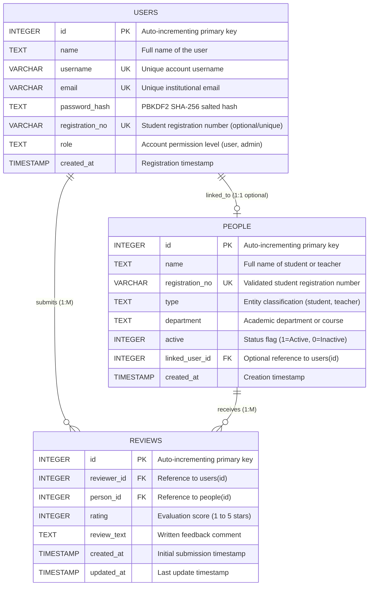

# Database Schema Documentation

This document provides the technical specification of the relational database architecture powering the **Student Feedback Management System**. The schema is engineered with dual database support for **SQLite** (local development) and **PostgreSQL** (production deployment via Supabase).

---

## Entity Relationship (ER) Diagram



---

## Table Specifications

### 1. `users` Table
Stores registered account credentials and profile metadata.

| Column Name | SQLite Data Type | PostgreSQL Data Type | Constraints | Description |
| :--- | :--- | :--- | :--- | :--- |
| `id` | `INTEGER` | `SERIAL` | `PRIMARY KEY` | Unique internal user identifier |
| `name` | `TEXT` | `TEXT` | `NOT NULL` | Full display name (e.g. `AMIT AGARWAL`) |
| `username` | `TEXT` | `VARCHAR(100)` | `NOT NULL, UNIQUE` | Unique login username |
| `email` | `TEXT` | `VARCHAR(255)` | `NOT NULL, UNIQUE` | Unique institutional email address |
| `password_hash` | `TEXT` | `TEXT` | `NOT NULL` | Salted PBKDF2 SHA-256 hash string |
| `registration_no`| `TEXT` | `VARCHAR(50)` | `NULLABLE, UNIQUE` | Linked student registration number |
| `role` | `TEXT` | `TEXT` | `NOT NULL, CHECK (role IN ('user', 'admin'))` | System access role |
| `created_at` | `TIMESTAMP` | `TIMESTAMP` | `DEFAULT CURRENT_TIMESTAMP` | Account creation timestamp |

#### Notes on `users`:
- Passwords are **never** stored in plaintext. They are hashed using `hashlib.pbkdf2_hmac` with 260,000 iterations and a cryptographically secure 16-byte random salt.
- The `registration_no` column is optional for faculty/staff but unique when provided to prevent duplicate registration number claims.

---

### 2. `people` Table
Stores the official academic directory of evaluation targets (students and faculty members).

| Column Name | SQLite Data Type | PostgreSQL Data Type | Constraints | Description |
| :--- | :--- | :--- | :--- | :--- |
| `id` | `INTEGER` | `SERIAL` | `PRIMARY KEY` | Unique person identifier |
| `name` | `TEXT` | `TEXT` | `NOT NULL` | Full name of student or teacher |
| `registration_no`| `TEXT` | `VARCHAR(50)` | `NULLABLE, UNIQUE` | Official registration number (e.g. `23BCON0028`) |
| `type` | `TEXT` | `TEXT` | `NOT NULL, CHECK (type IN ('student', 'teacher'))` | Target category |
| `department` | `TEXT` | `TEXT` | `NOT NULL` | Program, Department, or Course |
| `active` | `INTEGER` | `SMALLINT` | `NOT NULL DEFAULT 1, CHECK (active IN (0, 1))` | Directory visibility flag |
| `linked_user_id` | `INTEGER` | `INTEGER` | `NULLABLE, FOREIGN KEY REFERENCES users(id) ON DELETE SET NULL` | Linked registered account ID |
| `created_at` | `TIMESTAMP` | `TIMESTAMP` | `DEFAULT CURRENT_TIMESTAMP` | Record insertion timestamp |

#### Notes on `people`:
- Inactive people (`active = 0`) are excluded from review submission dropdowns but preserved in historical reporting.
- The master directory includes 62 verified students imported from `students_master.json`.

---

### 3. `reviews` Table
Stores feedback evaluations submitted by reviewers for students or faculty members.

| Column Name | SQLite Data Type | PostgreSQL Data Type | Constraints | Description |
| :--- | :--- | :--- | :--- | :--- |
| `id` | `INTEGER` | `SERIAL` | `PRIMARY KEY` | Unique review identifier |
| `reviewer_id` | `INTEGER` | `INTEGER` | `NOT NULL, FOREIGN KEY REFERENCES users(id) ON DELETE CASCADE` | Evaluator account ID |
| `person_id` | `INTEGER` | `INTEGER` | `NOT NULL, FOREIGN KEY REFERENCES people(id) ON DELETE CASCADE` | Evaluated target ID |
| `rating` | `INTEGER` | `SMALLINT` | `NOT NULL, CHECK (rating BETWEEN 1 AND 5)` | Numerical rating (1–5) |
| `review_text` | `TEXT` | `TEXT` | `NOT NULL` | Constructive written comment |
| `created_at` | `TIMESTAMP` | `TIMESTAMP` | `DEFAULT CURRENT_TIMESTAMP` | Initial submission timestamp |
| `updated_at` | `TIMESTAMP` | `TIMESTAMP` | `DEFAULT CURRENT_TIMESTAMP` | Last updated timestamp |

#### Critical Integrity Constraints on `reviews`:
- **Composite Unique Constraint:**
  ```sql
  CONSTRAINT uq_reviewer_person UNIQUE(reviewer_id, person_id)
  ```
  Enforces that **one reviewer can have exactly one active review per person**.
- **Atomic UPSERT Query:**
  When a user re-evaluates an individual, the system executes an atomic upsert:
  ```sql
  INSERT INTO reviews (reviewer_id, person_id, rating, review_text, created_at, updated_at)
  VALUES (?, ?, ?, ?, CURRENT_TIMESTAMP, CURRENT_TIMESTAMP)
  ON CONFLICT(reviewer_id, person_id)
  DO UPDATE SET
      rating = excluded.rating,
      review_text = excluded.review_text,
      updated_at = CURRENT_TIMESTAMP;
  ```
  This guarantees that duplicate submissions never corrupt statistical aggregates.

---

## Database Indexes

To optimize high-frequency search and filter queries, the following indexes are maintained:
1. `idx_reviews_person_id` on `reviews(person_id)` — Speeds up dossier generation and average rating queries.
2. `idx_reviews_reviewer_id` on `reviews(reviewer_id)` — Speeds up reviewer submission lookups and duplicate checks.
3. `idx_people_type_active` on `people(type, active)` — Accelerates directory dropdown filtering for active students/teachers.
4. `idx_people_registration_no` on `people(registration_no)` — Enables instant student search by registration number.
5. `idx_users_registration_no` on `users(registration_no)` — Accelerates self-review verification lookups.
