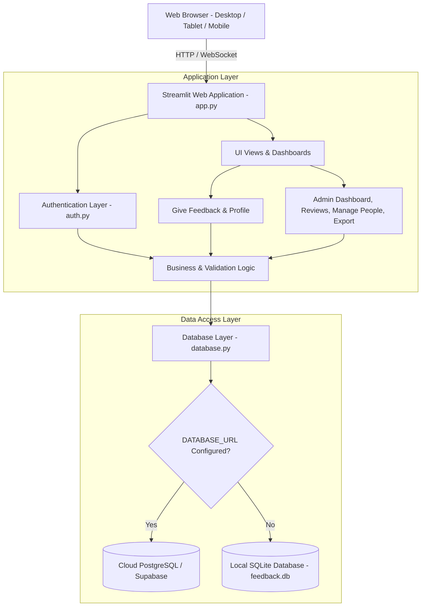
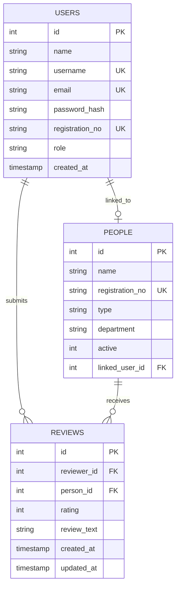
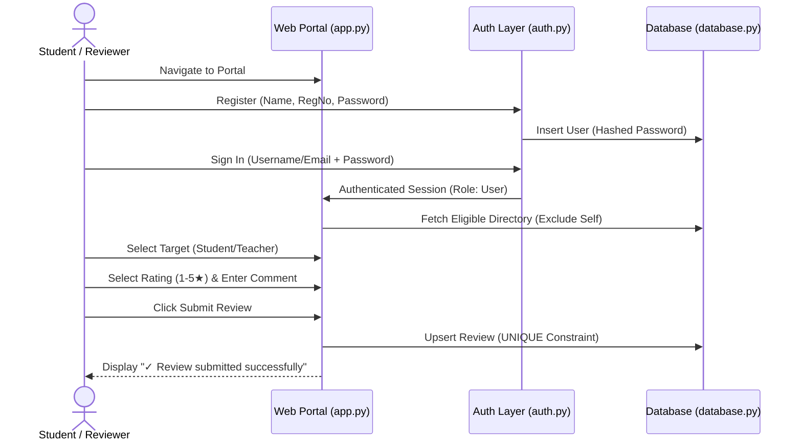
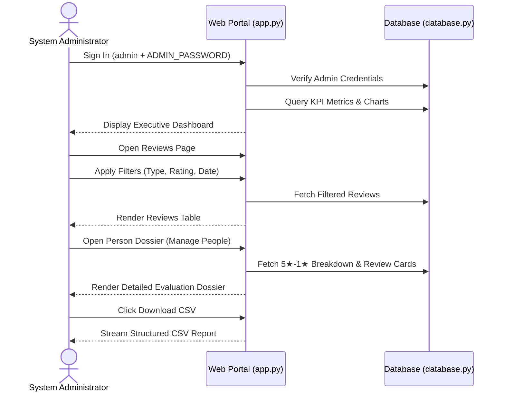

# Student Feedback Management System — Project Report

**Academic Mini-Project Report**  
**Author:** Khushi Jain Daga  
**Project Repository:** [khushi-jain-daga/student-feedback-system](https://github.com/khushi-jain-daga/student-feedback-system)  
**Academic Year:** 2026  

---

## Executive Summary

The **Student Feedback Management System (SFMS)** is a role-based web application developed using **Python, Streamlit, and Relational Database Systems (SQLite / PostgreSQL)**. The system is engineered to solve the persistent challenges of confidentiality, data integrity, and administrative overhead inherent in traditional academic feedback mechanisms. By establishing role-based access control (RBAC), strict reviewer anonymity from peers, self-review prevention, and automated aggregation, SFMS provides institutions with actionable intelligence to elevate teaching and learning quality.

---

## 1. Introduction

Academic feedback is essential for institutional growth, faculty development, and peer collaboration. In modern educational institutions, continuous evaluation enables departments to identify pedagogical bottlenecks, support students, and foster an environment of structured constructive criticism. However, realizing the benefits of feedback requires an evaluation mechanism that guarantees student anonymity while assuring administrators of authentic submissions.

The Student Feedback Management System introduces an institutional-grade evaluation workflow that balances accessibility with privacy. Built on top of Python and Streamlit, the platform delivers a modern Software-as-a-Service (SaaS) user experience while maintaining a dual database architecture (SQLite for local development and PostgreSQL via Supabase for cloud deployment).

---

## 2. Problem Statement

Traditional academic feedback collection suffers from systemic limitations that degrade the reliability of evaluations:
1. **Paper-Based Evaluations:** High administrative effort, paper wastage, slow distribution, and time-consuming manual tallying. Hand-written comments compromise student anonymity due to recognizable handwriting.
2. **Generic Forms (e.g., Google Forms / SurveyMonkey):** While digital, generic forms lack institutional directory integration. They do not validate student registration numbers, cannot prevent duplicate entries by the same individual, and make self-review prevention difficult.
3. **Absence of Role-Based Privacy Controls:** In basic custom scripts, feedback data is often exposed across student accounts or completely public, causing peer hesitation and biased, superficial ratings.
4. **Data Aggregation Delays:** Calculating average ratings, department-wide benchmarks, and rating distributions requires offline spreadsheet manipulation, leading to stale decision-making.

---

## 3. Objectives

The primary objectives of this project are:
- **Confidential & Secure Feedback:** Implement strict role separation ensuring normal users can never access submissions made by others or identify who reviewed whom.
- **Dual Evaluation Surface:** Provide structured evaluations for both student peers and faculty teachers within a single unified web platform.
- **Master Directory Validation:** Integrate a master student directory formatted with verified names and registration numbers (e.g., `AMIT AGARWAL — 23BCON0028`).
- **Fairness & Integrity Safeguards:** Enforce backend-level prevention of self-reviews and duplicate submissions (automatically converting repeated evaluations into updates of existing records).
- **Executive Admin Analytics:** Equip academic administrators with automated Key Performance Indicators (KPIs), rating distribution charts, person detail dossiers (5★ down to 1★ breakdowns), and one-click CSV export capabilities.
- **Universal Cloud Accessibility:** Ensure instant deployment to Streamlit Community Cloud backed by persistent cloud PostgreSQL on Supabase.

---

## 4. Scope

The scope of this project encompasses:
- **Student Reviewers:** Registration, authentication, directory search, star-rating evaluation (1–5 scale), qualitative comments submission, and review editing.
- **Academic Administrators:** Real-time KPI monitoring, multi-filter review inspection, moderation/deletion of policy-violating comments, student and faculty directory management (status toggles and profile updates), and data archiving via CSV.
- **Data Persistence:** Dual-engine database adapter with automatic schema migrations, supporting lightweight local SQLite storage and persistent cloud PostgreSQL hosting.

---

## 5. Existing System vs. Proposed System

| Dimension | Existing System (Paper / Generic Forms) | Proposed System (SFMS) |
| :--- | :--- | :--- |
| **Identity Validation** | None or manual email entry | Master directory integration with validated registration numbers |
| **Reviewer Privacy** | Easily compromised (handwriting / public sheets) | Strict cryptographic isolation; reviews visible only to administrators |
| **Duplicate Submissions** | Multiple duplicate entries skew aggregates | Database-level unique constraint with seamless review updating |
| **Self-Review Prevention** | Non-existent; students can review themselves | Triple-vector check (User ID, Registration Number, Full Name) |
| **Analytics Generation** | Manual spreadsheet aggregation taking days | Real-time automated KPI cards and dynamic distribution charts |
| **Data Export** | Disconnected data dumps | Filtered one-click CSV exports for reviews and people directory |

---

## 6. Proposed System Overview

The proposed **Student Feedback Management System** provides a single public web link supporting two distinct roles:
1. **Normal User (Student / Peer Reviewer):** Can register, sign in, evaluate active students or teachers from a verified directory, select ratings (1 to 5 stars), submit constructive feedback, and modify prior evaluations. Normal users have **zero access** to submissions from other students, average scores, or admin analytics.
2. **Administrator:** Authenticates using master credentials to access the executive control dashboard, view KPI metrics, inspect detailed dossiers for any student or teacher, search and filter reviews, moderate comments, manage directory records, and export CSV reports.

---

## 7. Functional Requirements

### 7.1 User Module Requirements
- **FR-U01 User Registration:** Users can register with Full Name, Username, Email, Password (minimum 8 characters), and optional Registration Number.
- **FR-U02 Secure Login:** Users authenticate using either their registered Username or Email address alongside their password.
- **FR-U03 Target Selection:** Users choose review type (*Student* or *Teacher*) via segmented controls.
- **FR-U04 Directory Search:** Users search and select individuals from an official directory formatted as `STUDENT NAME — REGISTRATION NUMBER` or `TEACHER NAME — DEPARTMENT`.
- **FR-U05 Rating & Commentary:** Users assign an objective 1–5 star rating with descriptive labels (Poor to Excellent) and enter written feedback.
- **FR-U06 Duplicate Review Updating:** Users reviewing an already evaluated individual have their prior submission loaded and seamlessly updated upon submission.
- **FR-U07 Self-Review Prohibition:** Users cannot view or select their own profile or any profile sharing their registration number or name.
- **FR-U08 Privacy Isolation:** Users only receive a clean success state upon submission (`✓ Review submitted successfully`) without exposing database contents.
- **FR-U09 Profile Management:** Users can view their account credentials and securely update their login password.

### 7.2 Administrator Module Requirements
- **FR-A01 KPI Dashboard:** Display real-time totals for Reviews, Registered Users, Students, Teachers, and Average Rating.
- **FR-A02 Visual Analytics:** Render dynamic charts for Reviews by Type and Rating Distribution.
- **FR-A03 Activity Monitoring:** Present a live feed of recent feedback submissions and rankings of top-reviewed individuals.
- **FR-A04 Review Filtering & Search:** Filter reviews by Type (Student/Teacher), Person, Rating, Date range, and keyword search, with a one-click `Reset Filters` control.
- **FR-A05 Full Review Inspection:** Inspect comprehensive review details including reviewer identity, target identity, registration numbers, timestamps, and commentary.
- **FR-A06 Review Moderation:** Permanently delete inappropriate submissions with mandatory checkbox confirmation.
- **FR-A07 Directory Management:** Search master students by name or registration number, toggle active/inactive status, edit details, and add new students or teachers.
- **FR-A08 Person Detail Dossier:** Display average ratings, total review counts, 5-star to 1-star distribution breakdowns, and individual review cards for any selected person.
- **FR-A09 Account Auditing:** Search and inspect all registered accounts without exposing password hashes.
- **FR-A10 CSV Data Export:** Generate and download structured CSV reports for All Reviews, Student Reviews, Teacher Reviews, and Master Directory records.

---

## 8. Non-Functional Requirements

- **Security:** Industry-standard PBKDF2 password hashing with SHA-256 and unique per-user salts. Session state authorization prevents URL/tab manipulation.
- **Performance:** Sub-second response times for review submissions, directory lookups, and analytics calculations.
- **Usability:** Clean SaaS dashboard interface designed in compliance with institutional visual standards.
- **Reliability:** ACID-compliant database transactions ensuring data integrity across concurrent user sessions.
- **Responsiveness:** Dynamic CSS media queries guaranteeing smooth navigation across Desktop (1280px+), Tablet (768px), and Mobile (390px) viewports.
- **Maintainability:** Modular software architecture separating presentation (`app.py`), authentication (`auth.py`), and persistence (`database.py`).

---

## 9. Technology Stack

- **Core Programming Language:** Python 3.10+
- **Frontend & Web Framework:** Streamlit (v1.32.0+)
- **Styling & Design System:** Vanilla CSS3 with Google Fonts (`Plus Jakarta Sans`, `Inter`)
- **Data Manipulation & Analytics:** Pandas (v2.0.0+)
- **Cryptography & Security:** Python Standard Library `hashlib` (PBKDF2 SHA-256 with 260,000 iterations), `secrets`
- **Local Persistence:** SQLite3 (Zero-configuration embedded engine)
- **Cloud Persistence:** PostgreSQL 15+ (Hosted on Supabase with `psycopg2-binary`)
- **Environment Management:** `python-dotenv` and Streamlit Cloud Secrets (`st.secrets`)

---

## 10. System Architecture



---

## 11. Module Descriptions

1. **Authentication Module (`auth.py`):** Handles user registration, credentials verification, password hashing, password updates, and administrator seeding from environment variables.
2. **Database Engine Module (`database.py`):** Provides an engine-agnostic persistence layer that detects SQLite or PostgreSQL, executes parameterized SQL queries, runs idempotent table migrations, and imports the master student directory.
3. **User Feedback Module (`app.py - render_user_dashboard`):** Guides the reviewer through a 4-step card interface (Type Selection → Person Selection → Rating Slider → Written Feedback) with automated self-review and duplicate review handling.
4. **Master Directory Module (`students_master.json` + `database.py`):** Automatically initializes and synchronizes the 62 verified student records with verified registration numbers.
5. **Admin Dashboard Module (`app.py - render_admin_dashboard`):** Computes executive KPIs and presents visual charts for distribution and review types.
6. **Review Management Module (`app.py - Reviews tab`):** Facilitates multi-parameter review filtering, textual search, full dossier inspection, and confirmed deletion.
7. **Person Detail Dossier Module (`database.get_person_detail`):** Compiles 5★ through 1★ rating breakdowns and individual review cards for any student or faculty member.
8. **Export Module (`app.py - Export tab`):** Serializes database query results into UTF-8 encoded CSV files for offline auditing.

---

## 12. Database Design & Schema

The relational schema consists of three core entities:
1. `users`: Stores registered user accounts, encrypted password hashes, roles, and optional student registration number linkages.
2. `people`: Stores the master directory of evaluation targets (students and teachers), their active statuses, departments, and linked user IDs.
3. `reviews`: Stores submitted evaluations, linking a reviewer to a evaluated person with a numeric rating, written comments, and timestamps.



*For comprehensive schema definitions, constraints, and data dictionaries, refer to [DATABASE_SCHEMA.md](DATABASE_SCHEMA.md).*

---

## 13. Security Architecture

1. **Password Encryption:** Passwords are never stored in plaintext. Passwords are cryptographically hashed using PBKDF2 with SHA-256 over 260,000 iterations and a cryptographically secure 16-byte salt (`hashlib.pbkdf2_hmac`).
2. **Protection of Credentials:** Password hashes are excluded from database select queries in admin views.
3. **Role-Based Access Control (RBAC):** Normal users cannot access admin pages by altering session keys. The router explicitly verifies `st.session_state.user['role'] == 'admin'`.
4. **Secrets Isolation:** No hardcoded database connection strings or master admin passwords exist in the source code. Credentials are read exclusively from `.env` or Streamlit Secrets.
5. **SQL Injection Defense:** All queries utilize parameterized SQL execution (`?` placeholder syntax for SQLite and `%s` parameterization for PostgreSQL), preventing SQL injection vulnerabilities.

---

## 14. Validation Rules

- **Self-Review Prohibition:** Enforced at both the UI layer (filtered dropdown) and backend database layer across three vectors:
  - Reviewer User ID matches target `linked_user_id`.
  - Reviewer Registration Number matches target `registration_no`.
  - Reviewer Full Name matches target `name`.
- **Duplicate Review Prevention:** A composite database constraint `UNIQUE(reviewer_id, person_id)` prevents multiple active records. Subsequent entries execute an atomic SQL `UPSERT` (`ON CONFLICT DO UPDATE`), updating rating and commentary.
- **Rating Bounds:** Ratings are strictly validated between 1 and 5.
- **Comment Validation:** Written feedback cannot be empty or purely whitespace.

---

## 15. Application Workflows

### 15.1 Student Reviewer Workflow


### 15.2 Administrator Workflow


---

## 16. Testing & Quality Assurance

The system incorporates automated unit and integration tests:
- **`tests/test_project.py` (8 Tests):** Validates user registration, duplicate rejections, PBKDF2 hashing, master student imports, self-review prevention via registration number and name, duplicate review upserts, and people management.
- **`tests/test_streamlit_app.py` (7 Tests):** Streamlit AppTest suite verifying landing page components, normal user dashboard isolation, password change mechanisms, admin KPI calculations, reviews filtering controls, directory tabs, and CSV download buttons.
- **End-to-End Browser Subagent Testing:** Full headless browser verification validating user registration, review submission, update workflows, self-exclusion, admin KPI rendering, and mobile responsiveness.

```bash
python -m unittest discover -s tests -p "test_*.py"
# Result: Ran 15 tests in ~27s — OK (All Passing)
```

---

## 17. Results

The finalized Student Feedback Management System delivers:
1. A modern, institutional SaaS web interface with high aesthetic polish.
2. Verified 62-student master directory pre-loaded with official registration numbers.
3. Sub-second feedback submission and dynamic review updating without duplicate pollution.
4. Total privacy protection for student evaluators.
5. Complete administrative oversight with real-time KPI metrics, detailed dossiers, and CSV downloads.

---

## 18. Advantages

- **Zero Software Installation:** Users access the portal directly through any web browser.
- **Enhanced Evaluation Honesty:** Strict privacy isolation eliminates fear of social backlash.
- **Data Integrity:** Database constraints guarantee one valid review per person per evaluator.
- **Actionable Insights:** Administrators can inspect granular 5-star to 1-star distributions rather than misleading single averages.
- **Low Operating Cost:** Can be hosted entirely free on Streamlit Community Cloud and Supabase Free Tier.

---

## 19. Limitations

To maintain academic honesty, the following real-world limitations are acknowledged:
- **No Institutional SSO:** Authentication relies on internal PBKDF2 accounts rather than university SAML/OAuth Single Sign-On.
- **No Email Verification:** Account registration currently does not dispatch SMTP verification tokens.
- **Manual Faculty Entry:** While students are pre-loaded from the master directory, teachers are added manually by the administrator unless pre-seeded.
- **Mini-Project Scope:** Designed for college departments and medium-sized cohorts (~1,000 users). Large-scale university deployments (>50,000 users) would require asynchronous task workers and microservices.

---

## 20. Future Enhancements

- **Institutional SSO / LDAP Integration:** Seamless authentication using college Google Workspace or Microsoft Azure AD accounts.
- **Email OTP Verification:** Validating registration via one-time passcodes sent to official university email addresses.
- **AI Sentiment Analysis:** Automated natural language processing (NLP) to detect tone, constructive suggestions, and flagged abusive language.
- **Department Benchmarking:** Comparative analytics comparing aggregate feedback scores across university academic departments.
- **Automated Notifications:** Email alerts notifying teachers when a semester review milestone is reached.
- **Native Mobile Application:** Cross-platform mobile app built with Flutter or React Native connecting to a FastAPI backend.

---

## 21. Conclusion

The **Student Feedback Management System** successfully resolves the critical limitations of paper-based and unverified feedback mechanisms. By combining strict cryptographic privacy, master directory validation, self-review prevention, and automated administrative analytics into a clean, modern web application, the project demonstrates how modern software engineering practices can elevate institutional academic governance. The platform is functionally complete, thoroughly verified with 15 passing automated tests, and fully prepared for cloud deployment.
