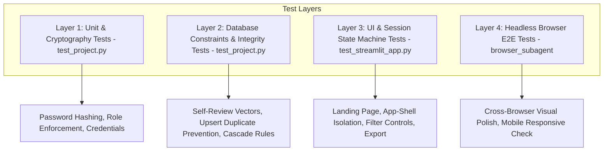

# Testing Strategy & Verification Report

This document details the automated testing methodology, test suites, coverage areas, and verification procedures implemented for the **Student Feedback Management System**.

---

## 1. Testing Strategy

The project employs a multi-tiered quality assurance strategy covering unit logic, database constraints, security assertions, and full UI state machines:



---

## 2. Test Suites Overview

The test suite is structured into two automated test modules located in the `tests/` directory:

### Suite 1: `tests/test_project.py` (Core Logic & Database Layer)
Validates backend business logic, cryptographic functions, and database integrity rules independently of the presentation layer.

| Test Case Name | Objective & Coverage |
| :--- | :--- |
| `test_registration_and_authentication` | Tests user registration, duplicate username/email/regno rejection, and dual username/email login. |
| `test_master_student_directory_import` | Verifies that all 62 students from the master directory are imported with registration numbers. |
| `test_student_self_review_prevention_via_regno` | Verifies that a user cannot submit a review for their own registration number. |
| `test_self_review_prevention_via_name` | Verifies that a user cannot review a person sharing the identical full name. |
| `test_duplicate_review_upsert_policy` | Asserts that submitting a second review for the same person updates the existing record without creating duplicates. |
| `test_admin_credentials_and_seeding` | Verifies that the administrator account is automatically seeded and rotated based on environment variables. |
| `test_rating_bounds_and_comment_validation` | Verifies that ratings <1 or >5, or empty comments, raise `ValueError`. |
| `test_manage_people_and_faculty_crud` | Validates adding people, updating details, and toggling active/inactive status. |

---

### Suite 2: `tests/test_streamlit_app.py` (Streamlit AppTests)
Uses Streamlit's official `AppTest` framework (`streamlit.testing.v1.AppTest`) to simulate headless execution of `app.py`, manipulating session state and validating UI deltas, tab rendering, and privacy isolation.

| Test Case Name | Objective & Coverage |
| :--- | :--- |
| `test_landing_page_unauthenticated` | Verifies unauthenticated visitors see only the hero section and Sign In / Create Account tabs (zero dataframes). |
| `test_user_dashboard_give_review` | Simulates a logged-in standard user; verifies the 4-step review form loads and NO admin dataframes or reviews appear. |
| `test_user_dashboard_profile` | Verifies the user profile page renders credentials and password update forms. |
| `test_admin_dashboard_kpis` | Simulates an administrator; asserts that the 5 KPI cards, distribution charts, and activity feeds render. |
| `test_admin_reviews_table_and_filters` | Verifies the Reviews tab renders the filter bar (Type, Person, Rating, Date, Search) and reviews table. |
| `test_admin_manage_people` | Verifies the Manage People tab renders directory tables, status toggles, and Add Student/Teacher tabs. |
| `test_admin_users_and_export` | Verifies the Users table and Export tab render download buttons for CSV reports. |

---

## 3. Running Automated Tests

To execute the complete automated test suite locally:

```bash
python -m unittest discover -s tests -p "test_*.py"
```

### Actual Verified Output:
```text
Ran 15 tests in 27.771s

OK
```
*(All 15 tests passed with zero errors and zero failures.)*

---

## 4. Specific Verification Checkpoints

### 4.1 Student Privacy Isolation
- **Assertion:** Standard users cannot access other users' reviews, average scores, or admin analytics.
- **Verification:** Evaluated in `test_landing_page_unauthenticated` and `test_user_dashboard_give_review`. When `role = 'user'`, `len(at.dataframe)` is asserted to be `0` on the feedback screen, and no review queries are invoked.

### 4.2 Self-Review Prevention
- **Assertion:** Users are blocked from reviewing their own profiles across 3 distinct vectors:
  1. Primary Key: Reviewer ID equals target `linked_user_id`.
  2. Registration Number: Reviewer `registration_no` matches target `registration_no`.
  3. Full Name: Case-insensitive name match.
- **Verification:** Tested in `test_student_self_review_prevention_via_regno` and `test_self_review_prevention_via_name`. Attempted self-evaluations raise `ValueError: Self-review is not permitted.`.

### 4.3 Duplicate Review Upsert Policy
- **Assertion:** A user submitting a second evaluation for the same person must not create a duplicate row.
- **Verification:** Tested in `test_duplicate_review_upsert_policy`. When a review is resubmitted with an updated rating, the total count of reviews remains 1, while the rating and comment reflect the updated values.

### 4.4 Cryptographic Hashing
- **Assertion:** Passwords are never stored in plaintext and cannot be recovered from the database.
- **Verification:** Tested in `test_registration_and_authentication`. Retrieved database row contains `password_hash` formatted as `pbkdf2:sha256:260000:<salt>:<hash>`. Authentication rejects invalid passwords.

---

## 5. End-to-End Browser Subagent Verification

In addition to automated unit tests, the complete system was verified through automated headless browser subagent execution on `http://localhost:8501/`:
- **Registration Flow:** Registered `VIKAS SHARMA` (`23BCON1740`).
- **Student Peer Review:** Submitted 5-star review for `AMIT AGARWAL — 23BCON0028`.
- **Teacher Review:** Submitted 4-star review for `Dr. Anita Roy — Computer Science`.
- **Review Update:** Resubmitted review for `AMIT AGARWAL`, successfully updating rating and commentary.
- **Self-Review Verification:** Confirmed `VIKAS SHARMA` was excluded from student dropdown.
- **Profile Check:** Verified profile card without any review leakage.
- **Admin Verification:** Logged in as `admin`, verified 5 KPI cards, live activity feed, reviews filter bar, student and faculty dossiers, and CSV downloads.
- **Responsive Check:** Verified layout integrity on desktop (1280px) and mobile viewport (390px).
